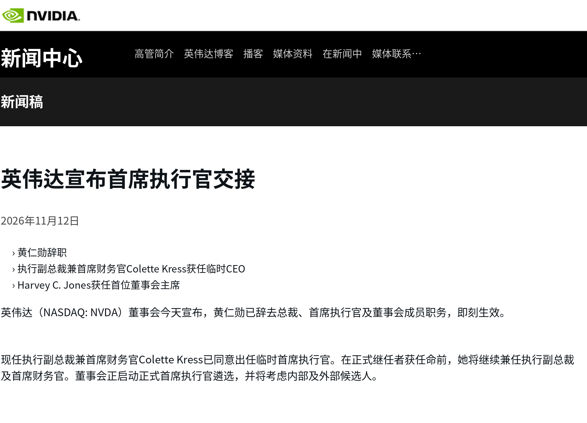
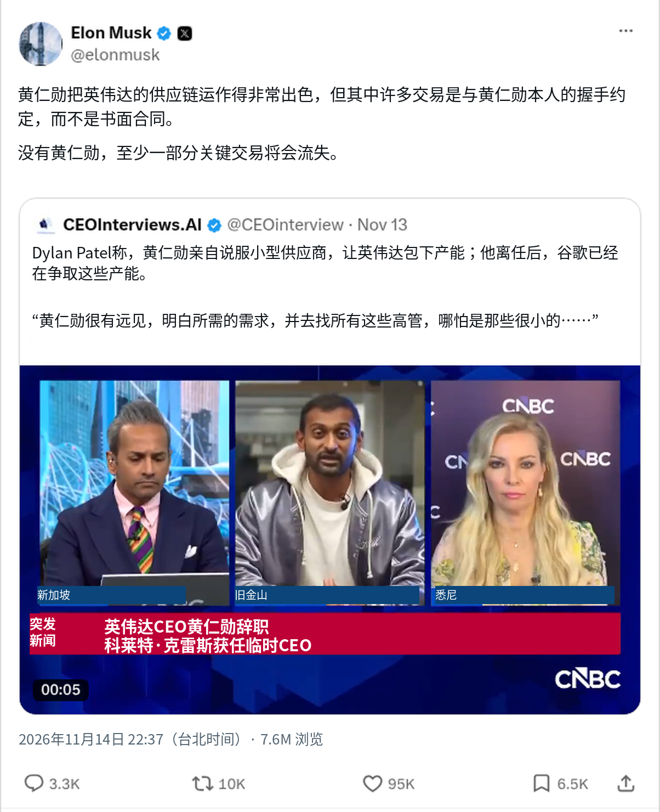
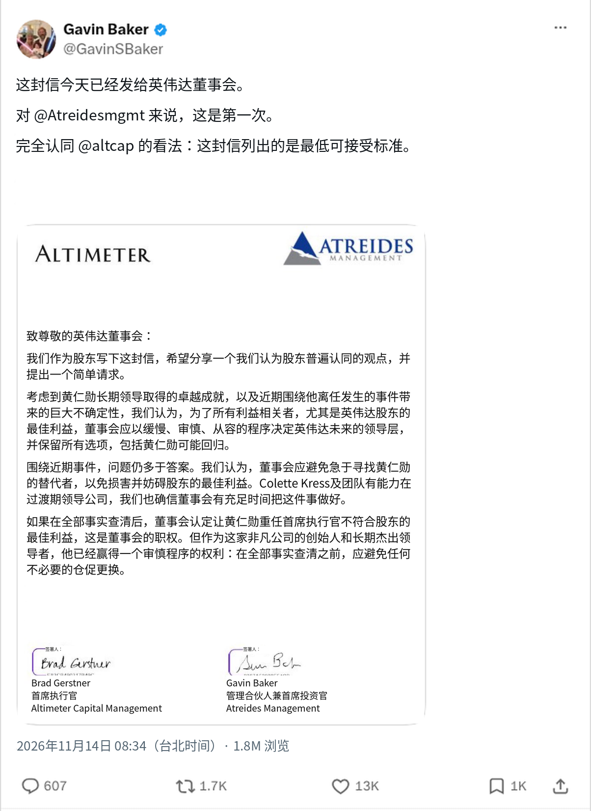
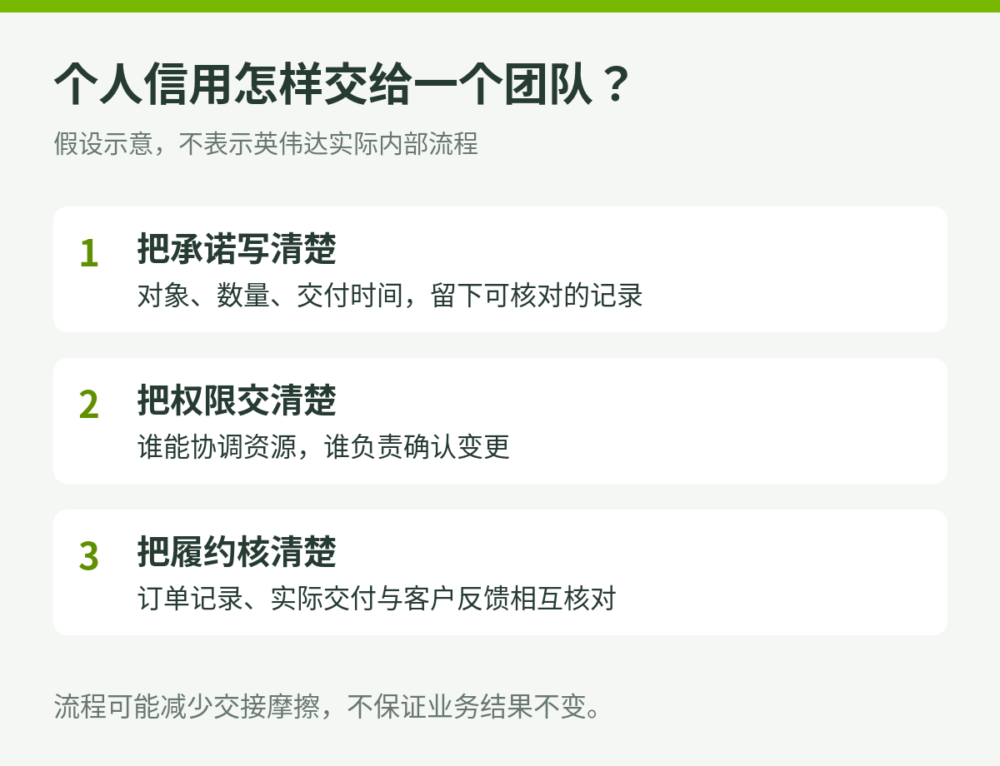

# 黄仁勋回归传闻升温，英伟达选帅到了哪一步？

## 传出商讨回归后，英伟达现在的掌门人是谁？

最近几天，围绕黄仁勋可能重返英伟达首席执行官岗位的消息在科技圈广泛传播。部分简短的传播标题容易把“私下商讨”与“即将复职”混为一谈，但场外探讨意愿与公司正式任免决定处于不同层面。

据路透社与CNBC转述《金融时报》引述知情人士的说法，黄仁勋正考虑重返该职位并与亲信讨论，其盟友正在组建协调团队以争取白宫支持。这则报道只说明盟友团队正在筹划，并不代表公司已经启动复职程序。

确认英伟达当前的管理层归属，直接依据是监管备案文件与公司正式公告。英伟达向美国证监会提交的8-K文件显示，董事会于11月11日接受黄仁勋辞去总裁、首席执行官及董事职务并即刻生效，随后在署期11月12日的公告中宣布了这一交接。

在英伟达投资者关系网站当前的管理团队页面上，长期担任公司首席财务官的克雷斯（Colette Kress）列为临时首席执行官，同时继续兼任执行副总裁与首席财务官。黄仁勋的名字则列在“创始人”栏下，反映出职务交接已经落地。

*图：官方公告原页的交接部分。公告署期11月12日；辞职生效日另据SEC文件为11月11日。 [原始来源](https://nvidianews.nvidia.com/news/nvidia-announces-ceo-transition)*

在这份交接公告中，英伟达董事会表示正启动正式首席执行官遴选，将考虑内部及外部候选人。公告同时提到，董事会预期公司日常经营、客户承诺与产品路线图不会受到中断。

需要注意的是，公告中关于经营不中断的表述属于董事会在交接时刻给出的预期说明，不能直接当成已经过独立核查的后续实际履约结果。

## 公司与华盛顿各方，对选帅放出了什么信号？

针对外界关于黄仁勋可能回归的传闻，英伟达官方给出的回应聚焦在选聘进度上。公司发言人对CNBC表示，目前正在挑选猎头公司，尚未正式接触任何潜在候选人，现阶段对任何个别人选进行猜测都为时过早。

据CNBC同一篇报道披露，围绕黄仁勋离任的相关情况，英伟达董事会目前正在进行一项独立调查。本轮已读报道没有给出调查结论，不能把调查正在进行，读成结论已经作出。

在公司外部，华盛顿政界人士对英伟达帅位走向给出了截然不同的公开表态。据NBC新闻与CNBC报道，美国总统特朗普在被问及黄仁勋回归的可能性时，给出了“我不会介意那样做”的原话，并称黄仁勋已经吸取了很大的教训。

这句话说明特朗普未公开反对回归，但它既不等于政府一致立场，也不是董事会任命。

美国财政部长贝森特则在采访中提出了明确指向外部的选帅要求。据路透社转述福克斯新闻的采访内容，贝森特表示英伟达必须到公司外部寻找新任首席执行官，进行一场“剧烈改组”，并要求董事会和外部律师在未来十天内就出口限制合规文化作出解释。

贝森特提到的“未来十天”是他在电视采访中提出的合规解释要求，现有公开材料并未显示这是一项具有法定效力的公开披露截止日，更不意味着回归讨论会在十天后自动终结。总统与财长发出的不同声音，反映出外部政治环境本身的复杂性。

## 马斯克预警交易流失，他说的握手约定指什么？

除了管理层选聘与政界表态，产业界更关心创始人离任会不会影响英伟达的业务合作。埃隆·马斯克在X发帖称：“黄仁勋把英伟达的供应链运作得非常出色，但其中许多交易是与黄仁勋本人的握手约定，而不是书面合同。没有黄仁勋，至少一部分关键交易将会流失。”

*图：马斯克的供应链原帖。其交易流失判断及嵌入卡片里的产能说法，不等于本轮已独立核实的经营结果。 [原始来源](https://x.com/elonmusk/status/2121613402846204253)*

在这条帖文里，马斯克给出了“至少一部分关键交易将会流失”的强烈预测。这位算力买家的担忧值得重视，但他的个人预测仍须与已核实事实分开。

在本轮已读的公开报道、监管文件与公司公告中，未找到独立证据表明英伟达已有关键交易因黄仁勋离任而流失。我们既不能替发言者弱化原话的警告语气，也不能把这一预测直接当成已发生的退单事实。

马斯克所说的“握手约定”具体指什么？他在随后的X回复中结合自身经历解释称，只要黄仁勋向他承诺了算力交付，或者他请求加速供应某些组件，黄仁勋总是能兑现；他们稍后会在某个时间点补上采购订单，但他从没怀疑过交付会落空。

这条补充提供了重要语境：至少在他自己描述的采购经历里，先凭个人信用推进合作，并不意味着之后没有书面订单。他强调的是自己对黄仁勋交付承诺的信任。

同时也要看到，这番说明反映的是马斯克作为算力买家与黄仁勋直接打交道的个人采购经历。外界不能仅凭单一客户的互动体验，就外推英伟达整个供应链的日常合同形态，也无法断定其他客户都采用同样的合作方式。

## 两家机构股东联名致信，是要求无条件复职吗？

在投资界，Atreides管理合伙人兼首席投资官加文·贝克（Gavin Baker）在X平台公开发布了一封当天致英伟达董事会的联名信，并表示这是该机构首次采取此类行动。这封信由他与Altimeter首席执行官布拉德·格斯特纳共同署名，贝克称信中列出的是最低可接受标准。

*图：Gavin Baker发布公开信的原帖。信中条件须与他随后支持立即复职的个人回复分开理解。 [原始来源](https://x.com/GavinSBaker/status/2121401397346521412)*

[放大阅读公开信完整中文替换图](img/source-letter-zh.png)

核对公开信全文可以看到，两位机构投资人提出了三层主张。第一层是关于选帅节奏：鉴于黄仁勋长期领导取得的卓越成就及近期离任事件带来的巨大不确定性，他们认为董事会应以缓慢、审慎、从容的程序决定未来领导层，并保留包括黄仁勋可能回归在内的所有选项。

第二层主张是认可现有过渡团队。信中指出，围绕近期事件的问题仍多于答案，董事会应避免急于寻找替代者以免损害股东最佳利益；他们同时表示克雷斯及团队有能力在过渡期领导公司，董事会有充足时间把事情做好。

第三层主张则明确承认董事会的决定权：如果在全部事实查清后，董事会认定让黄仁勋重任首席执行官不符合股东最佳利益，这是董事会的职权。他们只是强调，作为创始人和长期杰出领导者，他已赢得在全部事实查清前避免不必要仓促更换的审慎程序权利。

紧接着公开信原帖，贝克在下方补充发帖称，他个人也支持在等待独立调查结果期间立即让黄仁勋复职的请愿，但认为这封信是与董事会展开建设性对话的起点。这一定位把两家机构联署信的条件文本，与他个人的更强复职诉求区分开来。

因此，既不能因为公开信保留了董事会否决权，就误以为贝克本人反对立即复职；也不能用他的个人补充表态，覆盖掉信中认可克雷斯过渡及承认董事会职权的全文条件。同时，这封联名信仅代表两家署名机构，不能视为全体股东的共同立场。

至于网络请愿，YC负责人加里·谭也在X发帖称黄仁勋应获正当程序并确认已签名。据CNBC报道，该请愿虽有近18万个签名，但签名者身份均为自报且未经核验，不等于员工或股东票数；此外也有投资人如安东尼·斯卡拉穆奇公开表示不看好回归。

## 个人协调与组织承接，分别需要什么条件？

对比马斯克对交易流失的担忧与机构股东对过渡团队的认可，可以看到双方关注的层面并不相同。这也引出一个核心问题：大型科技企业的运转究竟在多大程度上依赖创始人个人协调，又在什么条件下能由组织平稳承接？

*图：编辑自制假设示意：个人协调能否交给组织，取决于记录、权限与履约；并非英伟达已披露的内部流程。*

由于外界看不到英伟达内部的合同与排产细节，不妨用一个明确的假设情境来说明机制。假设某硬件企业遇到大客户急需加速交付组件，创始人凭个人信用口头答应并协调优先排期，随后的采购订单再由双方团队按流程补齐。

在这一假设情境下，若要由组织体系平稳承接，前提是此前的口头承诺已录入内部排产系统、后续书面采购订单已签署落地，且紧急调货优先级有成文规则。满足这些条件时，即便掌门人交接，日常履约也能按既有制度推进。

反之，在同样假设下也存在难以直接承接的反例。如果某项供货意向仅停留在高管私下口头沟通、尚未进入排期系统或补齐订单，又或者涉及只有创始人才能拍板的非标资源让渡，那么换人后接手团队就可能面临重新核对口径的摩擦。

回到英伟达已核实的公开履历，官方目前仅确认临时首席执行官克雷斯长期担任首席财务官，并未称其长期分管具体技术或运营。机构公开信认可她与团队的过渡能力，只是署名股东的判断，不等于外界已核实其内部运营交接的实况。

上述例子只是可能的交接机制，并非英伟达内部实况。缺少合同细节与供应商确认时，断言“非创始人不可”或“换谁都毫无影响”，都缺乏足够依据。

## 面对人事传闻，普通人怎么看懂真实业务信号？

对普通读者来说，更切身的问题可能是：换帅会不会让显卡更贵、AI软件涨价，甚至影响服务？从公司人事变化到这些日常影响，中间还隔着具体产品、客户业务和实际交付，不能直接画等号。

就目前已经核实的公开材料而言，并没有任何证据显示英伟达此次管理层交接已经引发终端硬件涨价、消费级产品延期或日常软件服务中断。当然，外部观察者同样无法替公司打包票，保证未来的排产交付与客户合作绝对不会出现任何波动。

对普通读者来说，与其顺着没有证据支撑的长链条去焦虑日常开销，不如学会区分不同信源能够证明什么问题。比如社交平台上的高管发帖、投资人评论与网络请愿，主要用来帮助我们了解各方对人事变动的态度、诉求与担忧。

而要判断一家公司的法定管理权归属与选帅进展，主要公开依据是公司向监管机构提交的备案文件、董事会正式公告以及官方发言人的明确回应。无论场外游说或网络联署的热度有多高，在没有转化为董事会正式决议之前，都不会改变公司当前的治理架构。

至于评估高层变动有没有真正传导到业务层面，则需要看公司定期发布的财报数据、业绩指引，以及主要客户或供应链伙伴的正式业务说明。学会把情绪化的传播声量与实质性的经营披露分开看待，既不必轻信恐慌传言，也无需凭人事风波去盲目押注股价走向。

## 评估这场风波的走向，接下来该看哪些证据？

综合本轮核实的所有材料，我的判断是：黄仁勋重返首席执行官岗位一事，目前仍停留在亲信商讨、盟友筹划游说与部分投资人呼吁保留选项的场外阶段。在公司治理层面，尚未见到董事会正式推进其复职的公开依据。

判断的关键在于证据层级：交接文件能确认当前职务，场外讨论却不足以确认下一次任命。公司发言人回应的仍是猎头遴选，独立调查则据CNBC报道；两者都没有给出黄仁勋将复职的结论。

当然，有依据的判断应当随新证据的出现而修正。如果后续英伟达董事会或官方发言人明确确认将黄仁勋纳入正式候选人评估，或者监管备案文件、独立调查结果披露了支持其复职的实质进展，那么“回归尚在场外”的判断就需要相应调整。

在业务端，验证关键交易流失的预测同样需要严谨标准。一方面，季度总营收等总量指标往往滞后，总体平稳不代表毫无局部摩擦；另一方面，若有具体客户或可核对文件确认合作损失与此次换帅相关，才会为该预测提供较强支持，不能把任何延期都归因于交接。

眼下最近的公开观察窗口，是英伟达计划于台北时间11月18日清晨公布的最新财报及随后的电话会。虽然无法保证管理层届时一定会在电话会上回应选帅或调查问题，但正式披露的财报数据与业绩展望，仍能为观察过渡期业务提供直接参考。

在更多官方信息披露之前，把场外支持者的诉求、当事人的经验判断与公司的正式程序放在各自的位置上审视，或许是最稳妥的方式。当创始人的个人威望遇上现代上市公司的治理程序，你认为英伟达董事会此时最应该优先考量什么？

## 参考来源

1. NVIDIA官方交接公告：https://nvidianews.nvidia.com/news/nvidia-announces-ceo-transition
2. 英伟达向美国证监会提交的8-K文件：https://www.sec.gov/Archives/edgar/data/1045810/000104581026000082/nvda-20261111.htm
3. 英伟达官网管理层页面：https://investor.nvidia.com/governance/management-team/default.aspx
4. CNBC关于黄仁勋回归讨论与公司回应的综合报道：https://www.cnbc.com/2026/11/16/nvidia-jensen-huang-return-tech.html
5. 路透社转述《金融时报》关于黄仁勋与盟友讨论回归的报道：https://www.investing.com/news/stock-market-news/jensen-huang-discusses-comeback-as-nvidia-ceo-with-allies-ft-reports-5028065
6. NBC新闻关于美国总统特朗普表态的报道：https://www.nbcnews.com/politics/trump-administration/trump-support-jensen-huang-nvidia-ceo-rcna609597
7. 路透社转述福克斯新闻采访美国财长贝森特的报道：https://www.investing.com/news/economy-news/bessent-says-nvidia-must-go-outside-the-company-to-find-new-ceo-5028004
8. 埃隆·马斯克（Elon Musk）关于英伟达供应链的X原帖：https://x.com/elonmusk/status/2121613402846204253
9. 埃隆·马斯克（Elon Musk）补充说明算力交付与采购订单的X回复：https://x.com/elonmusk/status/2121624209675665519
10. 加文·贝克（Gavin Baker）发布致英伟达董事会公开信的X原帖：https://x.com/GavinSBaker/status/2121401397346521412
11. 加文·贝克（Gavin Baker）关于个人支持立即复职请愿的X补充帖：https://x.com/GavinSBaker/status/2121401401159098644
12. 加里·谭（Garry Tan）呼吁正当程序的X原帖：https://x.com/garrytan/status/2121462697787342932
